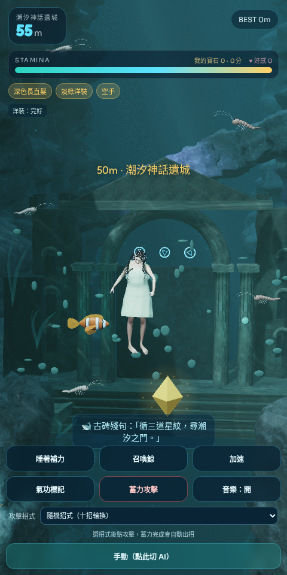
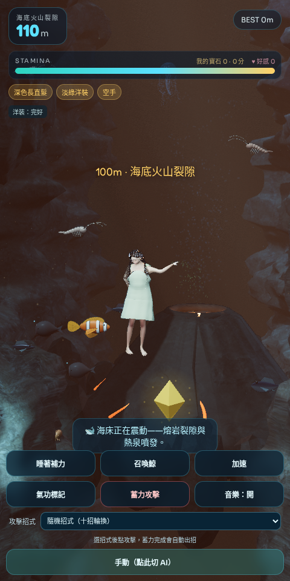
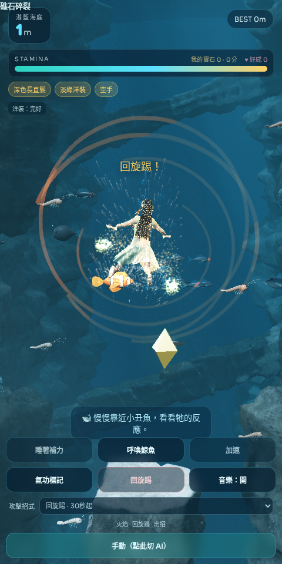

# Relics, personal treasure scores and elemental advection

The existing Cursor stacked-particle attacks remain in place. An additional bounded particle simulation retains wrist/ankle momentum, advects detached sparks through a divergence-free curl-style velocity field, applies drag and heat buoyancy, then cools and fades them. Strike bursts disperse outward; detached fire and light trails remain briefly after the attack ends. Fire, ice and cold-fire use different temperatures and colours. This is a real-time visual particle model, not full fluid CFD.

## Individual treasure

| Jewel           |     Value | Relative frequency |
| --------------- | --------: | -----------------: |
| Gold / 金曜石   | 10 points |                50% |
| Green / 翡翠晶  | 25 points |                32% |
| Purple / 紫星晶 | 60 points |                18% |

Faceted PBR crystals have emissive inner cores, soft halos and moving glints. The authoritative simulation picks the nearest eligible girl's posed body, after all girls move and their peer contacts resolve. A jewel can be claimed only once. Clients cannot submit scores or jewel values. Each name label shows count and points; the top HUD shows that player's own count and score. Expand **本局尋寶排行** in chat for the shared ranking, including offline participants.

Stamina, attack/whale cooldowns, world progression, dress repair and affection remain shared. Treasure collection still restores shared stamina and repairs dresses. Individual score lives for one run, survives the existing short reconnect reservation, and resets for everyone on an explicit new run. A late join begins at zero points without resetting the others. Additional bounded gem spawns provide opportunities for multiple players.

## Depth progression

| Depth        | Environment                                                                                                             |
| ------------ | ----------------------------------------------------------------------------------------------------------------------- |
| 0–49 m       | Existing seeded scenery every 10 m                                                                                      |
| 50–69 m      | Drowned tidal citadel: ruined columns, towers, carved steps and three luminous glyphs; clue: 「循三道星紋，尋潮汐之門」 |
| 70–99 m      | Return to a rocky canyon                                                                                                |
| 100–129 m    | Submarine volcanic rift: PBR basalt cone, incandescent fissures, hot ejecta and buoyant hydrothermal plume              |
| 130–159 m    | Star-drift water                                                                                                        |
| 160–189 m    | Green luminous forest                                                                                                   |
| 190–219 m    | Violet deep garden                                                                                                      |
| 220–249 m    | Crimson alien reef                                                                                                      |
| 250–279 m    | Amber/yellow grove                                                                                                      |
| 280–309 m    | Black abyss with character fill light and bioluminescence                                                               |
| 310 m onward | Repeat the six distinct 30 m deep-water bands                                                                           |

Six background organisms from three new designs appear after 130 m: glass ribbon rays, colonial siphonophores and armoured orbital nautiluses. They have articulated membranes, filaments or segmented bodies and emissive photophores. They are atmospheric background life. Existing hostile sharks and sea creatures retain their combat behaviour. The citadel and volcano are background landmarks, so they do not add invisible collision walls.

## Verification

`npm test` checks depth boundaries, weighted gem values, nearest-player selection and single-award rules in addition to the multiplayer tests. `tests/treasure-simulation.mjs` exercises actual server-owned game pickup, shared healing, separate scores, duplicate prevention, reconnection and run reset. `tests/relics-visual.mjs` renders test-positioned depth previews and actual attack phases; it checks WebGL errors, finite particle velocity and detached trails. These previews are explicitly not recorded playthroughs. `VISUAL_QUICK=1` verifies only the revised PBR landmarks. `tests/multiplayer-browser.mjs` also checks that each browser's own HUD and all head labels match the authoritative individual scores.

## Actual renderer previews

These are test-positioned scene previews, rather than a recorded dive. The three display crystals are enlarged to compare their materials.

Verification details: [assets/previews/v48/verification.json](assets/previews/v48/verification.json).
