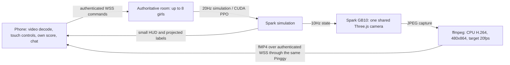

# Spark-rendered mobile play (v50)

Phones now default to the cloud view. An explicit `?render=cloud` URL also works
on desktop; `?render=local` keeps the original browser-rendered 3D mode. The title
screen offers a link to switch modes.

The original authored models are 38.72MB / 1,001,116 triangles for the girl and
9.51MB / 165,920 triangles for the whale. They remain unchanged. Previously every
phone downloaded and initialized them, plus Three.js, world textures, physics
helpers and effects. The cloud entry dynamically loads only the video player,
shared HTML controls, chat, audio and plain move definitions. It never requests
the GLBs, Three.js or the WebGL game module. External Google font requests were
removed from the entry page.



The source renderer was measured as `ANGLE (NVIDIA Corporation, NVIDIA GB10/PCIe,
OpenGL ES 3.2)`, not SwiftShader. Rendering uses the GPU; the installed ffmpeg has
libx264 and no NVENC encoder, so video encoding uses two CPU threads. One camera
and encoder are shared by all viewers. Each girl retains her own identity,
input, jewels and score. Shared stamina/whale/attack rules are unchanged. The
512px shadow map is a streaming quality setting; model geometry and materials
are not replaced by flat images.

The source targets 20 encoded frames/sec at about 1Mbps, with a 1.4Mbps rate cap.
The number of distinct captured frames depends on scene/party/GPU load and can
be below 20. The eight-client local test captured about 8.3 distinct frames/sec. These are transport targets, not a promise of 20 unique frames or
zero latency. Frames are generated from the live game, not a prerecorded video.
When no viewer remains, frame capture/rendering and encoder input pause.

The video connection is separate from commands/chat, uses the existing same
origin and `/stream`, and requires an active room token sent in the first
message, never in the URL. It does not consume an extra player slot. Late
viewers receive the MP4 init and latest decodable keyframe group. Buffers are
bounded; a slow viewer reconnects to the live edge instead of accumulating
minutes of old video. Closing the control connection closes that girl's video.

For iPhone, the player feature-detects ManagedMediaSource first, sets
`playsinline`, muted autoplay and `disableRemotePlayback`, and otherwise uses
MediaSource. A browser without supported H.264/MSE, a decode error or a stalled
video falls back to live JPEG frames. `?render=cloud&stream=jpeg` explicitly
chooses that fallback. JPEG transport uses more bandwidth for comparable motion
and is intended for compatibility. This is not WebRTC and needs no UDP/TURN
service beyond the existing Pinggy HTTPS/WSS tunnel.

The independent mobile tests disable WebGL and abort any attempted GLB, Three.js
or game3d module download. They decode real H.264 video, force an old-browser
JPEG fallback, send chat/whale/attack actions and reconnect video without
changing the girl's identity. Network emulation adds 100ms HTTP latency and a
300KB/s download setting; it is not a physical phone or real mobile-radio test.

Validation commands (use an idle isolated room):

```bash
npm test
node tests/cloud-browser.mjs
node tests/cloud-load.mjs
node tests/empty-room-browser.mjs
TEST_RENDER=local node tests/multiplayer-browser.mjs
```

Runtime results are in ignored `.runtime/cloud/`; a release summary is kept in
`docs/cloud-streaming-verification.json`. No additional model service or public
GPU endpoint is opened. The Node and GPU services still use ports 8765 and 8877.

References: [WebKit iPhone ManagedMediaSource support](https://webkit.org/blog/14735/webkit-features-in-safari-17-1/),
[WebKit media source and remote playback](https://webkit.org/blog/15036/how-to-use-media-source-extensions-with-airplay/),
[Pinggy tunnel types](https://pinggy.io/docs/cli/),
[FFmpeg format options](https://ffmpeg.org/ffmpeg-formats.html).

[Actual mobile-emulation screenshot](assets/previews/v50/cloud-phone.png).
