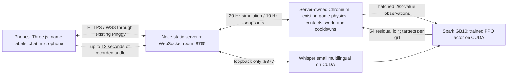

# Shared dive on Spark / Pinggy

Open the same Pinggy HTTPS URL on each phone. Enter a name, then choose **加入同一片海**. Suggested names come from Greek, Japanese, Norse, Egyptian, Celtic, Indian and Taiwanese goddesses. The server rejects occupied names and assigns a distinct dress colour. One shared sea supports up to eight connected girls; a full room gives a clear message.

Each player steers her own girl. Depth, health/stamina, sleep, dress repair, affection, whale visits and attack cooldowns are shared. Jewel counts and points are individual; see [ABYSS_RELICS.md](ABYSS_RELICS.md). Attack animation belongs to the girl who requested it. A late joiner receives the existing sea, not a new dive. The sea pauses while nobody is online; a service restart starts a new sea. No database or external account is needed.



The server runs the existing Three.js game's simulation without rendering frames. It advances the world once, updates every girl's individual locomotion, resolves posed body-sphere contacts between all girls, and publishes snapshots at up to 10 Hz (20 Hz simulation). Clients interpolate transforms and joint rotations and render hair, dresses, bubbles and combat effects locally. Entity creation recipes carry independent random seeds and counter values so late joiners reconstruct the same fish, predators and treasure. Terrain uses a shared seed; destroyed rocks and all entity transforms are authoritative.

The first girl has no host authority: closing her browser does not stop the world. Clients can submit only bounded destinations, allowlisted actions and chat. They cannot submit health, positions, rewards or cooldown values. Duplicate action requests still pass the original server-side combat/cooldown checks. Server-side CUDA actor inference batches all girls, with the identical local JS actor as a short-lived inference-error fallback. Physics/contact resolution remains on CPU; GPU use is for the actual learned actor and speech model, not a claim of full fluid CFD.

Typed chat appears in the common log and above the speaker. Messages are rendered with `textContent`, have length/rate/history limits, and are kept only in server memory. Disconnect notifications vary their wording. A 30-second reconnect token reservation retains a girl's identity; it never gives authority over another girl's avatar.

The microphone button records only after a click and browser permission. Click again to stop, or it stops after 12 seconds. Audio goes to the same Spark server, is decoded in memory with ffmpeg, and is transcribed by local Whisper CUDA. The returned text is an editable draft; press **送出** to share it. Audio is not stored. The GPU worker is bound to loopback, and transcription requests require a currently joined session, bounded upload size and rate limits. Modern phone browsers require the HTTPS Pinggy address for microphone access.

## Run

```bash
npm ci
npx playwright install chromium
# Use Spark's existing CUDA PyTorch environment; do not replace its Torch wheel.
/home/spark/env_isaaclab/bin/python -m pip install -r server/requirements-gpu.txt
hf download openai/whisper-small --local-dir /path/to/whisper-small
cp .env.example .env
# Set WHISPER_MODEL to that directory and check FFMPEG in .env.
bash scripts/install-multiplayer-service.sh
curl http://127.0.0.1:8765/api/health
```

Stop the previous Python static server on 8765 before starting this service. Keep the existing Pinggy forwarding target `127.0.0.1:8765`; WSS and microphone requests use that same origin and port. The installer manages only `deep-sea-fall.service` and `deep-sea-fall-gpu.service`, not other Spark workloads.

For development, run `python server/gpu_worker.py` in a CUDA environment, then `PORT=8897 npm start`. Set `WHISPER_MODEL` and `FFMPEG` in the process environment. `npm run start:solo` preserves the original standalone static game. A static hosting provider can still run solo mode, but multiplayer needs the Spark Node service behind Pinggy.

## Verification

`npm test` covers unique names/colours, reconnect reservations, varying disconnect messages, bounded/stale commands, unsupported state mutations and chat limits. `node tests/multiplayer-browser.mjs` exercises two independent browsers, late joining, labels/colours, literal-text chat, peer clearance, shared whale/attack and disconnect. `node tests/microphone-browser.mjs` uses an explicit fake microphone fixture to exercise MediaRecorder → authenticated upload → CUDA transcription → editable draft → shared chat. Set `TEST_URL`, `TEST_OUT` and `TEST_AUDIO` as needed. Runtime reports/screenshots are written under ignored `.runtime/`.

Implementation references: [ws WebSocket API](https://github.com/websockets/ws/blob/master/doc/ws.md), [Whisper](https://github.com/openai/whisper), [Transformers Whisper API](https://huggingface.co/docs/transformers/model_doc/whisper).
