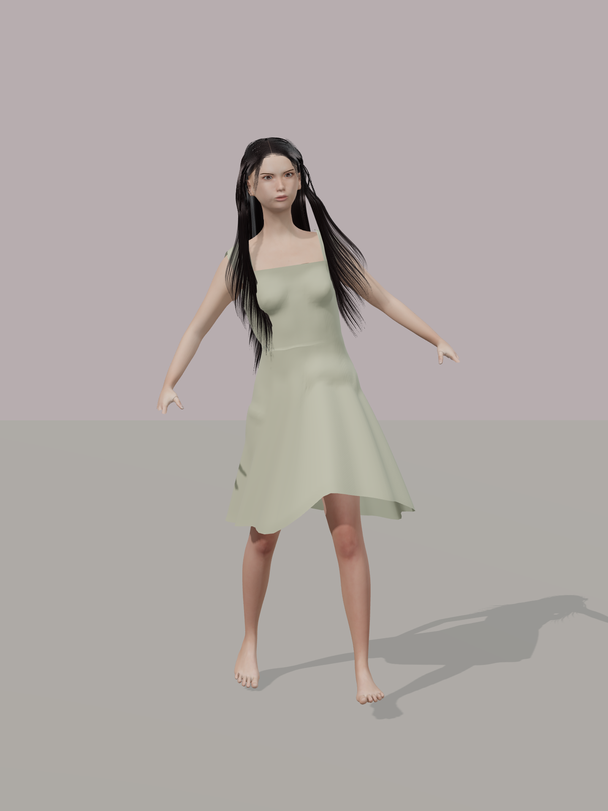
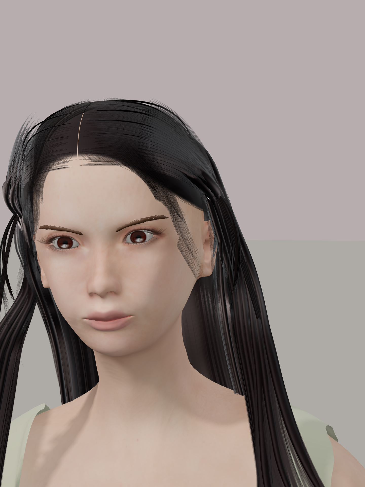
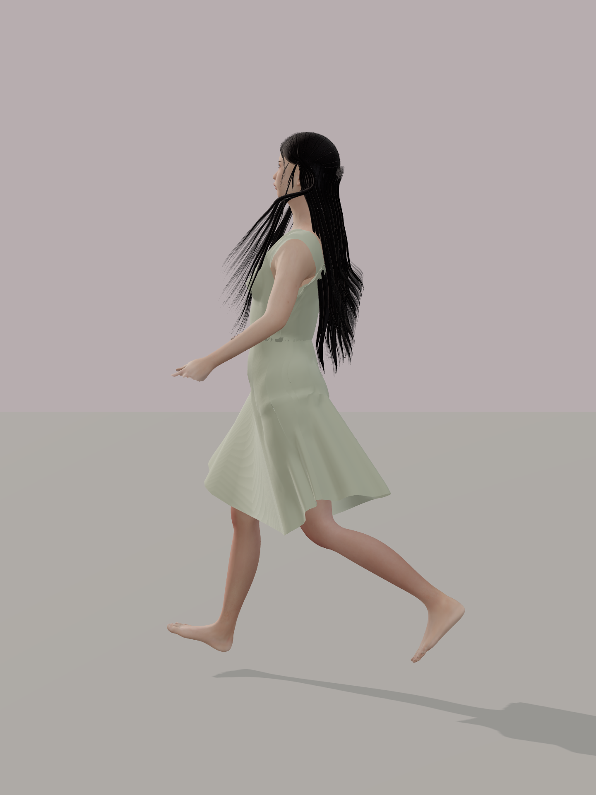
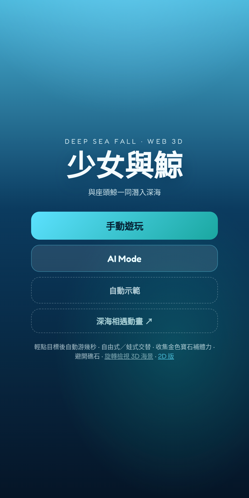
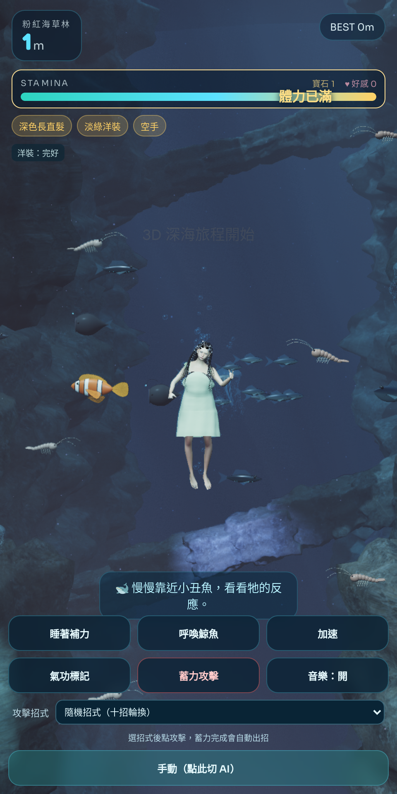
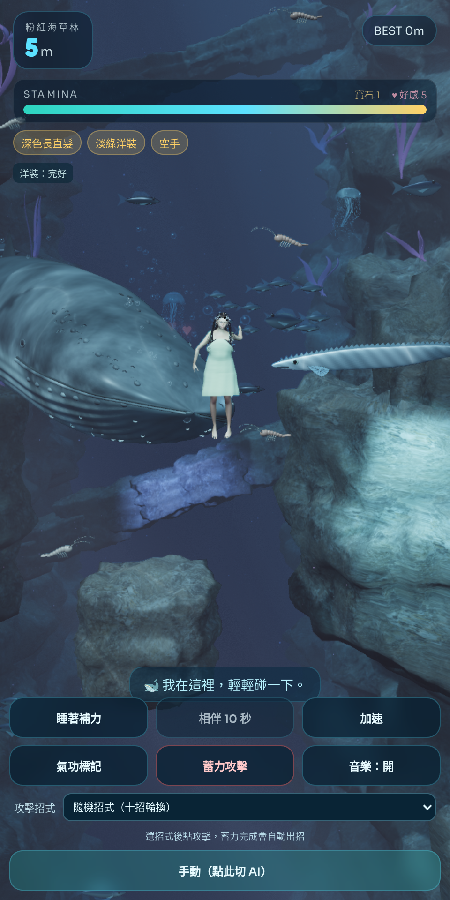

# Deep Sea Fall — 少女與鯨（混合架構）

## 深海遺城與個人尋寶

每位少女的寶石數與本局分數顯示在名字旁：金色 10 分、綠色 25 分、紫色 60 分。體力、招式與呼鯨仍共用。50 公尺遇見有三道星紋線索的海底遺城，70 公尺回到岩谷，100 公尺進入海底火山；130 公尺起每 30 公尺輪換星河、綠林、紫海、赤紅、琥珀和黑色深淵，加入三種異星海中生物。Cursor 的細緻粒子攻擊保留，新增受動作慣性、旋流與冷卻影響的火光拖尾。

規則、場景深度與驗證見 [ABYSS_RELICS.md](ABYSS_RELICS.md)。

## 多人一起下潛（Spark / Pinggy）

同一個 Pinggy 網址可讓最多八位少女一起游泳：可選名字、各自衣色、頭頂名字與聊天泡泡、角色碰撞，以及共用體力、呼鯨和攻擊冷卻。打字或點麥克風，由 Spark GB10 的 Whisper CUDA 轉成可確認的聊天文字。游泳 PPO 也由 Spark 批次推論；晚加入會同步現有深度，第一位玩家離開也不會終止海域。

啟動、架構與驗證見 [MULTIPLAYER.md](MULTIPLAYER.md)。`npm start` 啟動多人伺服器；`npm run start:solo` 保留單人版本。

目前玩得到的少女是深色長直髮、淡綠方領洋裝。下面三張直接來自現在的 `girl.glb`，取代 README 裡舊的短棕髮棚拍。

<p>
  
  
  
</p>

## 遊戲廣告

開頭是標題「與座頭鯨一同潛入深海」，進入後約 1 公尺處旅程開始。呼喚鯨魚後，座頭鯨從左側游到少女身旁。

<p>
  
  
  
</p>

### 和仁川機場媒體塔的對照

[Incheon Airport Media Tower: Girl and Whale](https://www.behance.net/gallery/248368373/Incheon-Airport-Media-Tower-Girl-and-Whale) 是 IMAGO 等人為仁川機場第一航廈 24 公尺 LED 媒體塔做的變形影像，2026 年 6 月公開。少女從上方沉入黑暗，座頭鯨從暗處現形，兩人對望後一起升向水面。整座垂直塔是一段沒有按鈕的影片，用 Cinema 4D、Houdini、Octane 與 After Effects 完成。

|          | 媒體塔原作                         | 這支遊戲                                             |
| -------- | ---------------------------------- | ---------------------------------------------------- |
| 開頭     | 少女從塔頂落入深海                 | 標題之後進入海面，約 1 公尺處看見少女、魚群和峽谷    |
| 鯨魚出現 | 鯨影從黑暗裡慢慢清楚，與少女對望   | 按下呼喚後，座頭鯨從左側游入，停在少女旁約十秒       |
| 尺度     | 巨鯨與小小少女填滿 24 公尺直式牆面 | 同一組對比收進直式手機畫面，旁邊有體力、魚群和操作   |
| 之後     | 一起上升，衝出明亮水面             | 繼續下潛，每 10 公尺換一座海底，可以游泳，也可以出招 |

原作畫面留在 Behance，這裡放的是我們自己的遊戲截圖。

## 2026-10-13 海景與游動重製 v4

- 拖曳時角色有交替划水、手肘與手腕動作、踢腿、傾身與轉向；睡眠切換成放鬆漂浮。
- 「召喚鯨」會讓座頭鯨從左側游入、移動到少女旁同行，鏡頭隨出場調整。重新開始可再次召喚。
- 海景改為立體破碎海谷、前景岩塊、掃描岩石 PBR 材質、水下光線積分、岩壁與角色陰影、動態焦散與懸浮微粒。
- 修正鯨體與鰭面朝內的法線，重新製作較寬的头部和正確的背腹色紋。
- 實際遊戲錄影：[`assets/previews/v4/swimming-and-summon.mp4`](assets/previews/v4/swimming-and-summon.mp4)。
- 檢查記錄與各頁截圖：`assets/previews/v4/`。詳見 [OCEAN_REWORK.md](OCEAN_REWORK.md)。

## 少女精修 v3 資產

- `model-review.html` — 少女、五官、座頭鯨與相遇場景，可旋轉／縮放。
- `cinematic.html` — 36 秒互動動畫，下沉 → 浮現 → 相遇 → 上升。
- `index.html` — 原有遊戲操作，使用同一套新版模型。
- 重建：`/home/spark/env_isaaclab/bin/python assets/scripts/rebuild_realistic.py`。
- 可編輯 Blender：`assets/refined/girl_reference_v3.blend`，貼圖已打包。
- 少女棚拍、遊戲截圖與驗證：`assets/previews/v3/`。

這版按照所提供的照片精修少女比例、五官、棕色低馬尾、分束瀏海與淡綠方領裙。
仍與原作有外觀、渲染和動作差異，並非原作資產或一比一複製。
詳見 [GIRL_REFINEMENT.md](GIRL_REFINEMENT.md)。下方是原專案使用方式。

垂直手機深海墜落遊戲：**Web 3D 可玩** + **Isaac Sim 寫實過場**。

靈感來自 [Incheon Airport Media Tower Girl and Whale](https://www.behance.net/gallery/248368373/Incheon-Airport-Media-Tower-Girl-and-Whale)。

## 架構

| 層級                 | 技術                  | 用途                                                |
| -------------------- | --------------------- | --------------------------------------------------- |
| **可玩遊戲（手機）** | Three.js WebGL 3D     | `index.html` — 霧、光柱、少女／鯨網格、深度生物群系 |
| **經典 2D**          | Canvas 2D             | `2d.html`                                           |
| **寫實 cinematic**   | Isaac Lab / Isaac Sim | `isaac_cinematic/` — Spark GPU 渲染垂直下潛預告片   |

## 遊玩（Web 3D）

```bash
cd ~/will/DeepSeaFall
npm start # 多人；先依 MULTIPLAYER.md 啟動 GPU worker
# 手機／瀏覽器：http://localhost:8765
# 2D：http://localhost:8765/2d.html
```

操作：拖曳游動、睡著補力、召喚鯨、加速、氣功標記、攻擊、AI Agent prompts。

## Isaac Sim cinematic

在已安裝 Isaac Lab 的 Spark 上：

```bash
cd ~/will/DeepSeaFall/isaac_cinematic
./run_cinematic.sh 90
# 輸出：output/deep_sea_isaac_cinematic.mp4
```

腳本會 headless 啟動 Isaac、以 Camera sensor 拍攝直式 720×1280 幀，再 ffmpeg 合成。

### 生成原創 USD（風格參考 Behance，非抓取對方檔案）

```bash
python assets/scripts/generate_usd_from_style.py
# 產出 assets/usd/girl.usda whale.usda deep_sea_stage.usda (+ .glb)
```

Isaac cinematic 會自動載入這些 USD；Web 3D 會載入對應 `.glb`。

### 角色預覽（PBR 材質 · 看少女與鯨）

寫實傾向 UsdPreviewSurface：skin / hair / dress / 濕鯨 clearcoat（ior + specular）。

```bash
cd isaac_cinematic && ./export_character_previews.sh
# 產出 assets/previews/character_*.png + character_orbit.mp4
```

頁首的三張是目前角色。`assets/previews/v3/` 的短棕髮棚拍是較早的精修，留作對照。

最新的海景與角色即時動畫：[`cinematic.html?v=42`](cinematic.html?v=42)。`assets/previews/v2/deep-sea-encounter.mp4` 與 `character_orbit.mp4` 均為舊版預覽。

## Demo 錄影

```bash
npm run record:long   # 長示範（Web）
npm run upload:gofile -- demo/...
```

## Repo

https://github.com/willnien10005914/DeepSeaFall
